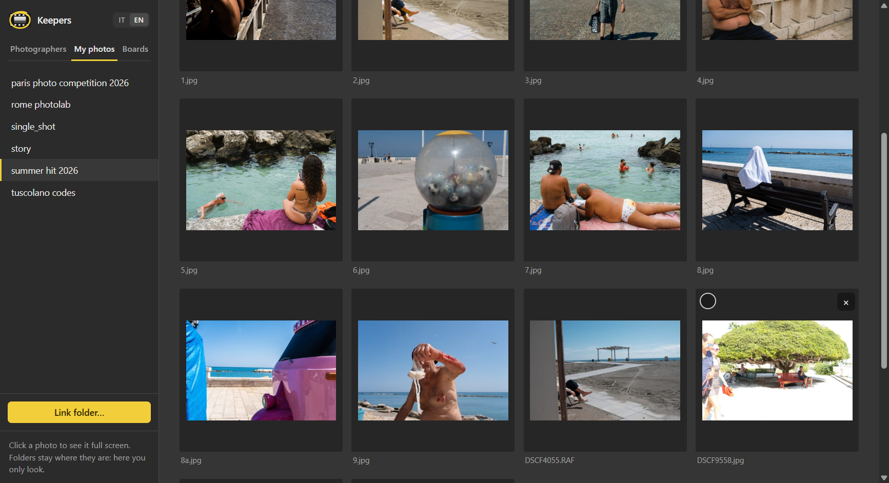
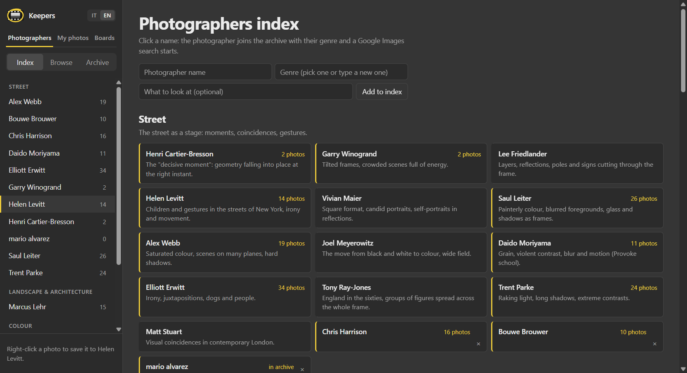
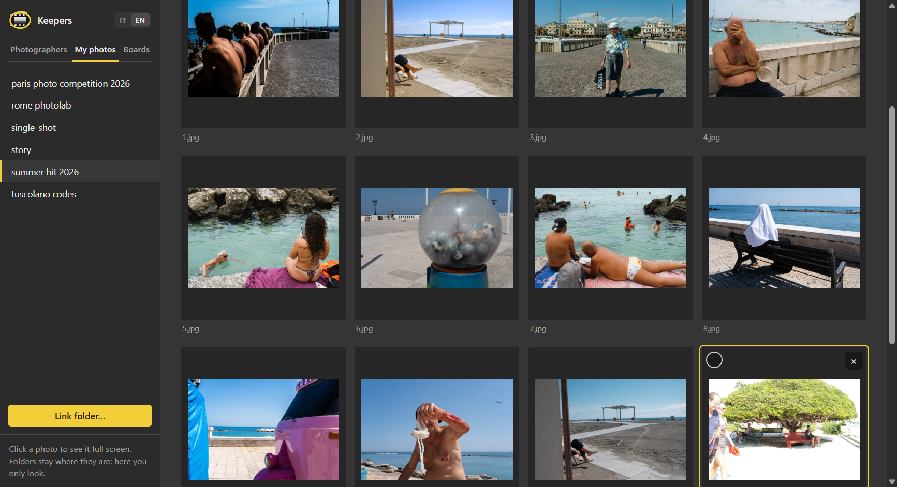
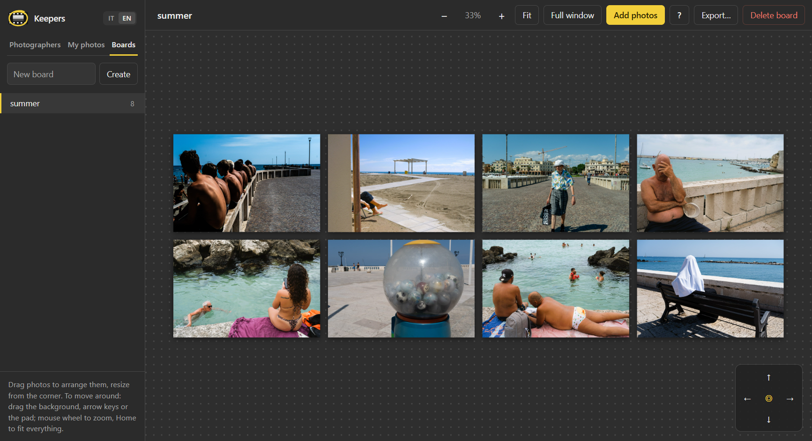
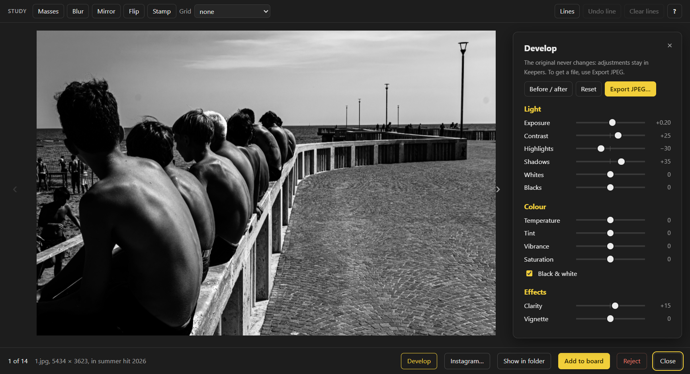
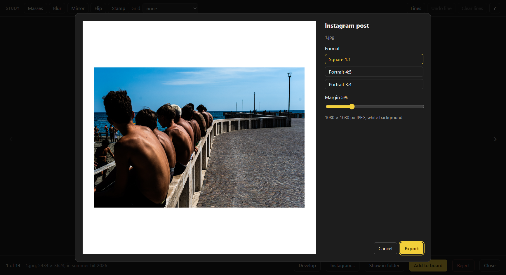

# Keepers

**Collect, study and compose reference photos.** Keepers is a Windows app for photographers (street photographers above all) who want to learn from the masters. With Keepers you can:

- build a personal archive of the photographers you love;
- look at their pictures with tools for reading composition;
- put them next to your own on a board to compose sequences and stories;
- develop your own photos and prepare them for Instagram.

Everything stays on your computer: no account, no cloud, no subscription.



[Versione italiana](README.md)

---

## Download and install

1. Go to [**Releases**](../../releases/latest) and download `Keepers-Setup-<version>.exe`.
2. Run the file you downloaded.
3. Windows will probably show the blue **"Windows protected your PC"** screen. It appears because the installer isn't signed with a paid certificate. Click **More info**, then **Run anyway**.
4. Choose the install folder (the suggested one is fine) and confirm. Keepers will be on your desktop and in the Start menu.

Requirements: 64-bit Windows 10 or 11. To update, download the new installer and run it: it replaces the old version, and your photos stay where they are.

---

## The three sections

### 1. Photographers: your archive of the masters

**Index.** A list of photographers grouped by genre (Street, Humanist, Documentary & reportage, Portrait, Colour…), each with a note on what to look at in their work.
- Click a name to add the photographer to your archive and immediately open a Google Images search.
- For someone who isn't listed, fill in the **Add to index** form: a name, a genre (pick one or type a new one) and an optional note.



**Browse.** A browser inside the app. Use it like any browser: Google Images, the photographer's site, Instagram, articles, the Magnum archive…
- When you find a picture you like, use **right-click → Save to &lt;photographer&gt;**. Right-click also works on Instagram, where photos are covered by transparent layers, and Keepers picks the largest version available.
- **Save page to links** remembers the photographer's site or profile so you can find it again.
- The same photo is never saved twice.

**Archive.** The photographer's contact sheet. Click a photo to see it full screen and use the arrow keys to move through the photos. From here you can also:
- use **Import folder…** to bring in photos you already have on your computer, for example from a scanned book;
- set the photographer's genre;
- review your rejects.

> Tip for Google Images: the thumbnails in the grid are small. Click a result, wait for the large version to appear on the right, and save that one.

### 2. My photos: your folders, without copying them

**Link folder…** shows the photos in a folder on your computer, including subfolders. Keepers doesn't copy or change anything: it reads the photos where they are.
- Formats: JPEG, PNG, WebP, GIF, AVIF and **Fujifilm RAW (.RAF)**. For RAF files Keepers shows the JPEG embedded by the camera, with the film simulation. Other RAW formats aren't supported yet.
- **Show in folder** opens File Explorer on the photo.



**AI search (optional).** **Tag with AI** analyses the photos in a folder (colours and content). Afterwards you can search for things like *bicycle*, *shadows*, *red*, *person from behind*. The tags stay hidden: they're only used for search.
- Colour analysis always works.
- Recognising content needs [Ollama](https://ollama.com), which is free and runs locally, so your photos never leave your computer. Once it's installed, open a Command Prompt and type:
  ```
  ollama pull qwen2.5vl:7b
  ```
  The model is about 6 GB. With an NVIDIA graphics card it takes 1–2 seconds per photo; without one it takes much longer.

### 3. Boards: composing stories

A board is an infinite surface where you lay out photos: your own, the masters', or both. Use it to try sequences, pairs and diptychs.
- **Add photos** opens the drawer: drag photos onto the board. The drawer only shows photos that aren't on the board yet.
- Drag a photo to move it, use its bottom-right corner to resize it and the mouse wheel to zoom. Double-click a photo to see it full screen.
- **R** makes every photo the size of the selected one, **Ctrl+O** / **Ctrl+V** line them up in a row or a column, and **Ctrl+Z** undoes. The **?** button lists all the shortcuts.
- **Full window** gives the board the whole screen.
- **Export…** creates a folder with the composition as a JPEG, the individual photos in reading order and a list of where each one came from.



Photos on a board are only references: nothing is copied.

---

## Studying composition

In the full-screen view there's a **Study** bar. The tools don't impose rules: they help you *see* a photo's structure, and they stay on as you move from one photo to the next.

| Tool | Key | What it's for |
|---|---|---|
| Masses | T | Reduces the photo to 2 or 3 values (notan) to show where light and shadow carry weight |
| Blur | B | Like squinting: only masses and directions remain |
| Mirror / Flip | M / U | Fresh eyes on the photo, without reading its subject |
| Stamp | F | The photo shown tiny: does it still hold up? |
| Grid | G | Thirds, golden section, diagonals (rectangle armature), centre |
| Lines | L | Draw guide lines and directions by hand (hold Shift for freehand); they're saved |

The **?** button (or H) opens a guide on how and when to use each tool.

---

## Develop: the light and colour of your photos

Open one of your photos full screen and click **Develop** (D key).
- **Light:** exposure, contrast, highlights, shadows, whites, blacks.
- **Colour:** temperature, tint, vibrance, saturation, black & white. In black & white, temperature and tint act as a colour filter, like film filters.
- **Effects:** clarity, vignette.

Double-click a slider to reset it, and **Before / after** (\\ key) shows the original. The study tools work on the developed photo: with **Masses** you see right away how the weights change.

The original never changes: adjustments stay in Keepers and a yellow dot marks the thumbnail. Thumbnails and boards keep showing the original. To get a file, use **Export JPEG…**, which creates a new full-resolution one (without EXIF data). On RAF files you develop the JPEG embedded by the camera. The masters' photos can't be developed.



---

## Instagram: your photos on a white background

- **One photo:** in the full-screen view, click **Instagram…**.
- **A whole project:** on a board, click **Instagram…**. Keepers creates a folder of files numbered in reading order, ready for a carousel. The masters' photos stay out, and a notice says how many.

In the preview, choose the format, **square 1:1** (1080×1080), **portrait 4:5** (1080×1350) or **3:4** (1080×1440), and the margin. The photo stays whole and centred, and your Develop adjustments are applied.



---

## Reject: Keepers never deletes a photo

**Reject** (X key, or × on a thumbnail) moves the photo to a `_scarti` (rejects) folder that you can review. From there, **Restore** puts it back where it was. You can select many photos at once with Ctrl+click, Shift+click or the circle on each thumbnail.
- In your own folders, a photo's twin files move with it (for example `DSCF0537.RAF` + `DSCF0537.JPG`).
- Emptying the rejects folder is up to you, in File Explorer.

---

## Where is my data?

| What | Where |
|---|---|
| Photographers' archive, boards, lines, Develop adjustments, tags | `Pictures\Keepers\` |
| Settings and thumbnails | `%APPDATA%\Keepers\` |

To back everything up, copy the `Pictures\Keepers` folder. Uninstalling Keepers (Settings → Apps) doesn't touch your photos.

---

## Language

Italian or English: switch with **IT | EN** at the top left.

## A note on rights

The photos you collect belong to their authors. Keepers is meant for **personal study**: keep them for yourself and don't republish them. That's also why saving is always manual, one photo at a time, chosen by you.

## Problems and ideas

Open an issue in the [**Issues**](../../issues) tab, or just get in touch.
