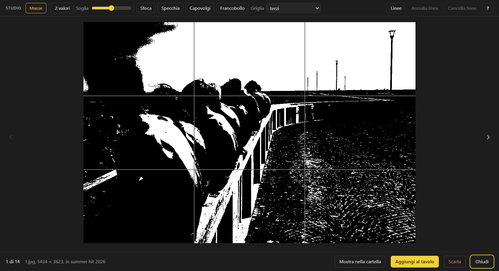
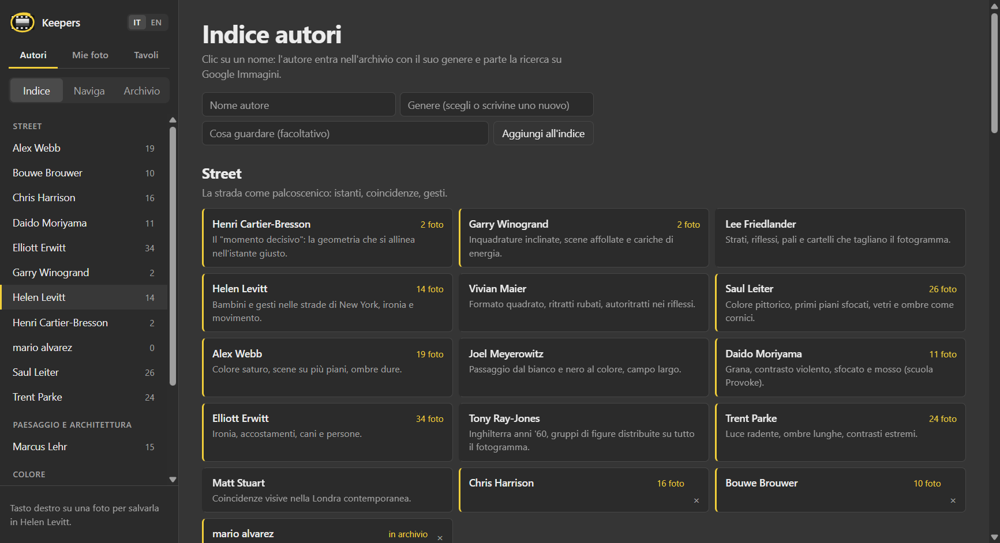
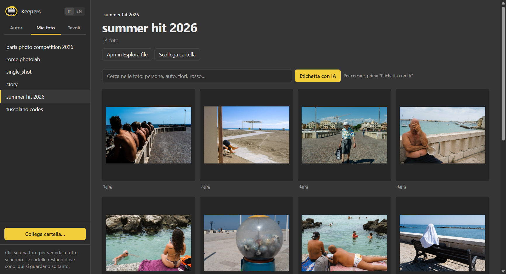
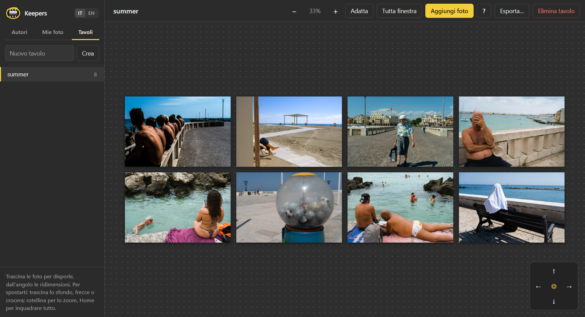

# Keepers

**Raccogli, studia e componi foto di riferimento.** Keepers è un'app per Windows pensata per chi fotografa (soprattutto street) e vuole studiare i maestri. Con Keepers puoi:

- costruire un archivio personale delle foto dei fotografi che ami;
- guardarle con strumenti per leggere la composizione;
- metterle accanto alle tue su un tavolo, per comporre sequenze e storie.

Funziona tutto sul tuo computer: niente account, niente cloud, niente abbonamenti.



[English version](README.en.md)

---

## Scaricare e installare

1. Vai su [**Releases**](../../releases/latest) e scarica `Keepers-Setup-<versione>.exe`.
2. Avvia il file scaricato.
3. Windows mostrerà probabilmente l'avviso blu **"Windows ha protetto il PC"**. Compare perché l'installer non è firmato con un certificato a pagamento. Clicca **Ulteriori informazioni**, poi **Esegui comunque**.
4. Scegli la cartella di installazione (va bene quella proposta) e conferma. Troverai Keepers sul desktop e nel menu Start.

Requisiti: Windows 10 o 11 a 64 bit. Per aggiornare, scarica il nuovo installer e avvialo: sostituisce la versione precedente e le tue foto restano dove sono.

---

## Le tre sezioni

### 1. Autori: il tuo archivio dei maestri

**Indice.** È un elenco di fotografi divisi per genere (Street, Umanista, Documentario e reportage, Ritratto, Colore…), ciascuno con una nota su cosa guardare nel suo lavoro.
- Un clic su un nome aggiunge l'autore al tuo archivio e apre subito la ricerca su Google Immagini.
- Per un autore che non c'è, compila il modulo **Aggiungi all'indice**: nome, genere (scegline uno o scrivine uno nuovo) ed eventualmente una nota.



**Naviga.** È un browser dentro l'app. Usalo come un browser qualsiasi: Google Immagini, il sito del fotografo, Instagram, articoli, archivi Magnum…
- Quando trovi una foto che ti interessa, fai **tasto destro → Salva in &lt;autore&gt;**. Il tasto destro funziona anche su Instagram, dove le foto sono coperte da livelli trasparenti, e l'app sceglie la versione più grande disponibile.
- **Salva pagina nei link** memorizza il sito o il profilo dell'autore, così lo ritrovi.
- La stessa foto non viene mai salvata due volte.

**Archivio.** È il foglio provini dell'autore. Fai clic su una foto per vederla a tutto schermo e scorri con le frecce. Da qui puoi anche:
- **Importa cartella…**: porta nell'archivio le foto che hai già sul computer, per esempio da un libro scansionato;
- impostare il genere dell'autore;
- rivedere gli scarti.

> Consiglio per Google Immagini: le miniature della griglia sono piccole. Clicca il risultato, aspetta che a destra compaia la versione grande e salva quella.

### 2. Mie foto: le tue cartelle, senza copiarle

**Collega cartella…** mostra nell'app le foto di una cartella del computer, sottocartelle comprese. Keepers non copia e non modifica niente: legge le foto dove sono.
- Formati: JPEG, PNG, WebP, GIF, AVIF e **RAW Fujifilm (.RAF)**. Per i RAF si usa il JPEG che la fotocamera incorpora nel file, con la simulazione pellicola. Gli altri RAW per ora non sono supportati.
- **Mostra nella cartella** apre Esplora file sulla foto.



**Ricerca con l'IA (facoltativa).** Con **Etichetta con IA** Keepers analizza le foto della cartella (colori e contenuto). Dopo puoi cercare per esempio *bicicletta*, *ombre*, *rosso*, *persona di spalle*. Le etichette restano nascoste e servono solo alla ricerca.
- L'analisi dei colori funziona sempre.
- Per riconoscere il contenuto serve [Ollama](https://ollama.com), gratuito e in locale: le foto non escono dal tuo computer. Dopo averlo installato, apri il Prompt dei comandi e scrivi:
  ```
  ollama pull qwen2.5vl:7b
  ```
  Il modello pesa circa 6 GB. Con una scheda video NVIDIA ci vogliono 1–2 secondi a foto, senza molto di più.

### 3. Tavoli: comporre storie

Un tavolo è una superficie infinita su cui disporre foto: le tue, quelle dei maestri, o entrambe. Serve a provare sequenze, coppie e dittici.
- **Aggiungi foto** apre il cassetto: trascina le foto sul tavolo. Il cassetto mostra solo quelle non ancora usate.
- Trascina per spostare, usa l'angolo in basso a destra per ridimensionare e la rotellina per lo zoom. Il doppio clic apre la foto a tutto schermo.
- **R** porta tutte le foto alla misura di quella selezionata, **Ctrl+O** / **Ctrl+V** le allineano in riga o in colonna e **Ctrl+Z** annulla. Il pulsante **?** mostra tutte le scorciatoie.
- **Tutta finestra** dà al tavolo tutto lo schermo.
- **Esporta…** crea una cartella con la composizione in JPEG, le singole foto in ordine di lettura e un elenco con la provenienza di ciascuna.



Le foto sul tavolo sono solo riferimenti: nessuna copia.

---

## Studio della composizione

Nella visione a tutto schermo c'è la barra **Studio**. Gli strumenti non impongono regole: aiutano a *vedere* la struttura di una foto e restano attivi mentre passi da una foto all'altra.

| Strumento | Tasto | A cosa serve |
|---|---|---|
| Masse | T | Riduce la foto a 2 o 3 valori (notan): si vedono i pesi di luce e ombra |
| Sfoca | B | Come strizzare gli occhi: restano masse e direzioni |
| Specchia / Capovolgi | M / U | Guardi la foto con occhi nuovi, senza leggerne il soggetto |
| Francobollo | F | La foto piccolissima: regge ancora? |
| Griglia | G | Terzi, sezione aurea, diagonali (armatura del rettangolo), centro |
| Linee | L | Tracci a mano linee guida e direzioni (Maiusc per il tratto libero); vengono salvate |

Il pulsante **?** (oppure H) apre una guida su come e quando usare ogni strumento.

---

## Scarta: Keepers non cancella mai una foto

**Scarta** (tasto X, oppure × sulla miniatura) sposta la foto in una cartella `_scarti`, che si può rivedere. Da lì **Ripristina** la rimette al suo posto. Puoi anche selezionarne molte insieme: Ctrl+clic, Maiusc+clic o il cerchietto sulla miniatura.
- Nelle tue cartelle, insieme alla foto vengono spostati i file gemelli (per esempio `DSCF0537.RAF` + `DSCF0537.JPG`).
- Svuotare gli scarti spetta a te, da Esplora file.

---

## Dove sono i miei dati

| Cosa | Dove |
|---|---|
| Archivio degli autori, tavoli, linee, etichette | `Immagini\Keepers\` |
| Impostazioni e miniature | `%APPDATA%\Keepers\` |

Per un backup basta copiare la cartella `Immagini\Keepers`. Disinstallando Keepers (Impostazioni → App) le tue foto non vengono toccate.

---

## Lingua

Italiano o inglese: lo scegli con **IT | EN** in alto a sinistra.

## Una nota sui diritti

Le foto che raccogli appartengono ai loro autori. Keepers serve per lo **studio personale**: tienile per te e non ripubblicarle. Per lo stesso motivo il salvataggio è sempre manuale, una foto alla volta, scelta da te.

## Problemi e suggerimenti

Apri una segnalazione nella scheda [**Issues**](../../issues), oppure scrivimi direttamente.
